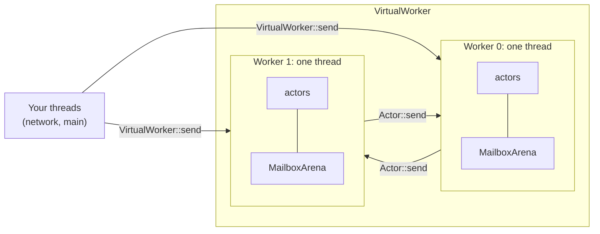
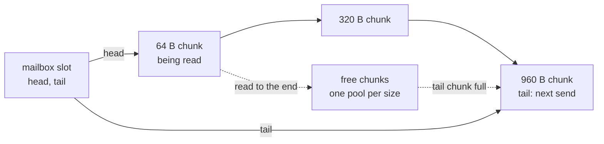
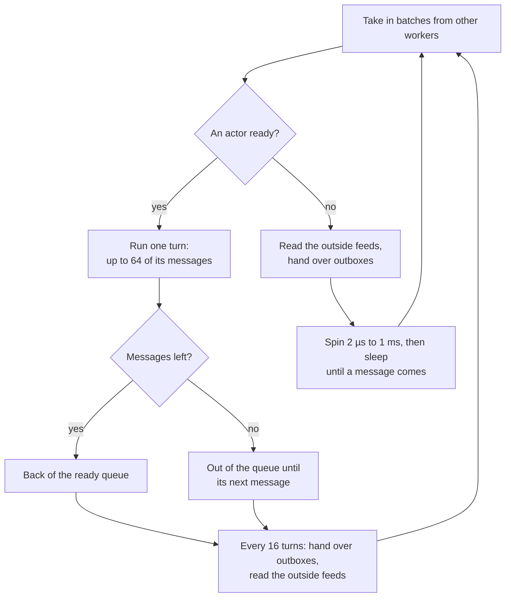
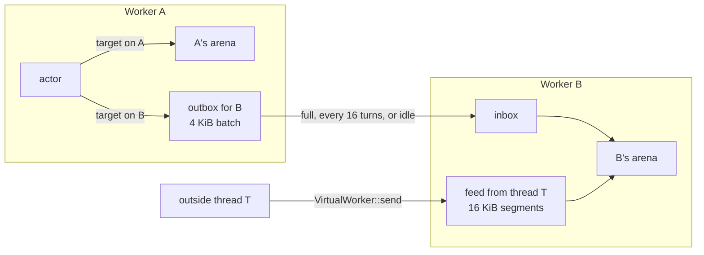

# actorlib

**A small, fast actor runtime for C++20.** You write each actor as plain single-threaded
code: a class that owns its state and handles one message at a time. actorlib runs your
actors on every core.

- **Bloat-free.** About 1,400 lines of code in two headers and one source file. It needs
  only the standard library.
- **Fast.** No locks anywhere on the message path. A message from one actor to another on
  the same worker takes about 7 ns, and 4 workers move about 470 million messages per
  second between their actors.¹
- **Efficient.** Messages live in memory each worker reserves up front, so sending a
  message almost never allocates. A quiet mailbox costs 64 bytes and grows with its
  load. A hard cap, with backpressure on the senders, keeps a fast producer from flooding
  the process.
- **Parallel out of the box.** Each worker keeps its mailboxes in a **MailboxArena**, and
  the **VirtualWorker** does the scheduling for you. There is one worker thread per core,
  actors are spread across them, every actor gets fair turns, and idle workers spin for a
  time that adapts to the traffic before they sleep.

**Contents:** [Hello, actor](#hello-actor) · [Quick start](#quick-start) ·
[Core concepts](#core-concepts) · [Examples](#examples)

## Hello, actor

```cpp
#include <actorlib/virtual_worker.hpp>

#include <cstdio>

constexpr int kRounds = 3;

// Messages are plain structs. A Ping carries the ref to reply to.
struct Pong {
    int round;
};
struct Ping {
    int round;
    actorlib::ActorRef<Pong> reply_to;
};

// Answers every Ping with a Pong.
class Ponger : public actorlib::Actor<Ping> {
public:
    void onMessage(const Ping& ping) {
        send(ping.reply_to, Pong{ping.round});
        if (ping.round == kRounds) stop();
    }
};

// Sends the next Ping each time a Pong comes back.
class Pinger : public actorlib::Actor<Pong> {
public:
    explicit Pinger(actorlib::ActorRef<Ping> ponger) : ponger_{ponger} {}

    void onMessage(const Pong& pong) {
        std::printf("pong %d\n", pong.round);
        if (pong.round == kRounds) {
            stop();
            return;
        }
        send(ponger_, Ping{pong.round + 1, self()});
    }

private:
    actorlib::ActorRef<Ping> ponger_;
};

int main() {
    actorlib::VirtualWorker system;  // one worker thread per core
    const auto ponger = system.addActor<Ponger>();
    const auto pinger = system.addActor<Pinger>(ponger);  // on the next worker
    system.start();
    system.send(ponger, Ping{1, pinger});  // the first Ping, sent from outside the actors
    system.join();                         // returns once every actor has stopped
}
```

```text
pong 1
pong 2
pong 3
```

The two actors run on different threads, yet neither one holds a lock. Each actor's state
belongs to it alone, and the only way to reach it is to send the actor a message.

## Quick start

Add actorlib to your `CMakeLists.txt`:

```cmake
include(FetchContent)
FetchContent_Declare(actorlib
    URL https://codeload.github.com/paoloanzn/actorlib/zip/refs/tags/v0.2.0
    URL_HASH SHA256=95d04f08d9dba6f5a647fc05769ded7e5cb674767c27bbdad6783ef2fcaf5848
)
FetchContent_MakeAvailable(actorlib)
target_link_libraries(my_app PRIVATE actorlib::actorlib)
```

## Core concepts

Each section below builds on the one before it:

1. [Actors, messages and refs](#actors-messages-and-refs): what you write.
2. [MailboxArena](#mailboxarena): where messages wait.
3. [VirtualWorker](#virtualworker): who runs the actors, and when.
4. [Messages between threads](#messages-between-threads): how a message reaches another
   worker, and what happens when the workers fall behind.



### Actors, messages and refs

An **actor** is a class that derives publicly from `actorlib::Actor<M>` and has a public
`onMessage(M&)` (or `const M&`). Its members are its state. The library builds the actor,
calls `onMessage` once per message, one message at a time, always on the same thread, and
destroys the actor once it stops. No other thread ever touches that state.

Inside `onMessage`, an actor can call:

| Call | Effect |
|---|---|
| `send(ref, args...)` | Builds a message in the mailbox of the actor `ref` points to, on any worker. |
| `spawn<A>(args...)` | Creates an actor on this actor's worker and returns its ref. |
| `self()` | This actor's own ref, for replies. |
| `stop()` | Ends the actor after the current message. The messages left in its mailbox are dropped. |

An actor's constructor cannot send, spawn or call `self()` yet. If `onMessage` throws, the
program terminates.

A **message** is any type that satisfies the `Message` concept: trivially copyable, not an
array, aligned to at most 64 bytes, and small enough to fit in one mailbox chunk (952 bytes
by default). Messages are copied as bytes and never destroyed, so they own nothing: use
numbers, enums and fixed-size arrays, not `std::string` or `std::vector`. Each actor takes
one message type. A `std::variant` of message structs carries several kinds.

An **`ActorRef<M>`** is the typed address of an actor: sending the wrong message type fails
to compile. A ref packs the actor's worker, its mailbox slot and a generation. When an
actor stops, its slot's generation changes, so an old ref fails with `DeadActor` and never
reaches a newer actor that reuses the slot. Each arena starts its generations at a different
value, so a ref used with another `VirtualWorker` fails the same way. A default-constructed
ref is null.

Every send returns a `SendResult`:

| Result | From an actor (`Actor::send`) | From outside (`VirtualWorker::send`) |
|---|---|---|
| `Ok` | Delivered, or handed to the target's worker. | Queued for the target's worker. |
| `Full` | The target is on this worker and its arena is at `max_bytes`, or this actor sent another worker its whole transit budget within one `onMessage` (see [backpressure](#backpressure)). | The workers are behind. Wait and send again (see [backpressure](#backpressure)). |
| `DeadActor` | The target is on this worker and has stopped, or the ref is null. | The ref is null. |

A message to an actor on another worker is checked when that worker delivers it. If the
actor has stopped by then, the message is dropped and counted in
`VirtualWorker::droppedMessages()`.

### MailboxArena

Every worker has one `MailboxArena`, which holds the mailboxes of all of its actors. A
mailbox is a FIFO queue of **chunks**. A send constructs the message in place at the
mailbox's tail, and the actor reads it at the head. A chunk goes back to the free pool as
soon as it has been read. Messages never move, and sends and reads allocate only when a
pool has to grow.



- **Size classes.** Chunks come in 64, 320 and 960 bytes by default. Each new chunk a
  mailbox takes is one class bigger than its last, so a mailbox holding one message uses
  64 bytes and a busy one reads long runs from 960-byte chunks. An empty mailbox holds no
  chunk, and it restarts one class below the last chunk it gave back, so busy mailboxes
  restart near their size and quiet ones shrink.
- **Parking.** A mailbox that keeps emptying and refilling (request and reply) keeps its
  last chunk instead of trading it with the pool on every message. At most 64 chunks are
  parked, and the arena takes them back before it grows.
- **Growth and the cap.** Each pool grows by slabs of `initial_bytes`. All pools together
  stop at `max_bytes`, and a send that needs a chunk past the cap returns `Full`.

`ArenaConfig` sets these limits for each worker's arena:

| Field | Default | Notes |
|---|---|---|
| `chunk_size` | `960` | The largest chunk, and so the largest message. A multiple of 64; prefer odd multiples such as 960 or 4032, which measured faster than powers of two. |
| `initial_bytes` | 1 MiB | Size of each slab. |
| `max_bytes` | 64 MiB | Cap on chunk memory, per worker. |

### VirtualWorker

A `VirtualWorker` owns the worker threads. Each **worker** owns an arena, the actors whose
mailboxes are in it, and a **ready queue** of the actors that have messages. Only the
worker's own thread touches them, so the scheduler takes no locks either.



- **Placement.** `addActor` places actors on the workers in turn. `spawn` places an actor on
  the worker of the actor that calls it. Actors never move.
- **Fairness.** A turn handles at most 64 messages. A busy actor then goes to the back of
  the queue, so it cannot starve the others on its worker.
- **Idling.** A worker with no work spins before it sleeps, because waking a thread costs
  microseconds. The spin adapts to the usual gap between messages, from 2 µs to 1 ms.

The lifecycle:

| Call | Thread | Effect |
|---|---|---|
| `addActor<A>(args...)` | Before `start()`: one thread. After: any thread. | Builds `A(args...)` on the next worker and returns its ref. After `start()`, it waits until the actor is built, and throws `std::logic_error` once every actor has stopped. |
| `start()` | Any | Starts one thread per worker and returns at once. |
| `send(ref, args...)` | Any | Sends from outside the actors. |
| `join()` | Any | Waits until every actor has stopped. |
| `stop()` | Any | Every actor stops after the message it is handling. |
| `~VirtualWorker()` | | Calls `stop()` and `join()` if the workers are still running. |

`VirtualWorkerConfig` has two fields: `workers` (default `0`, one per hardware thread, at
most 256) and `arena`, the `ArenaConfig` of each worker.

### Messages between threads

A message takes one of three paths, depending on who sends it:

| Sender | Path |
|---|---|
| Actor, to an actor on the same worker | Straight into the target's mailbox. |
| Actor, to an actor on another worker | Appended to an **outbox batch** (4 KiB) for that worker. The batch goes to the worker's **inbox**, in one compare-exchange, when it is full, every 16 turns, or when the sending worker runs out of work. The receiver copies each message into its arena before its next turn. |
| A thread outside the workers | Appended to that thread's **feed** to the target's worker: a queue of 16 KiB segments with one writer and one reader. No lock, no compare-exchange. |



**Ordering.** Messages from one actor to another arrive in the order they were sent, and
so do the messages one outside thread sends to an actor. Messages from different senders
have no order between them. This is what makes an end-of-stream message safe: it is always
the last message its receiver gets from that sender.

**Waking.** Handing over a batch, or writing to a feed, wakes the target's worker if it
sleeps. On Linux and macOS, sends from outside skip the full memory fence this would need:
a worker about to sleep makes the sending threads run one instead. Linux has the `membarrier`
system call for this. On macOS, the worker reads each sending thread's registers, which makes
the kernel interrupt that thread. That costs the worker a few microseconds, so it is worth it
only for a worker that gets many messages from outside between two sleeps (256 or more).
With fewer, the worker asks the senders to run the fence themselves and sleeps without
interrupting them. On other systems, each send from outside always runs the fence itself.

#### Backpressure

Each arena has a fixed cap, so the workers slow the senders down instead of growing
without bound:

1. A worker whose arena has more than half of `max_bytes` in use, while it has actors to
   run (paused ones included), is **pressured**.
2. While any worker is pressured, no worker reads the outside feeds. Messages from outside
   wait in their feeds while the workers catch up.
3. Once 32 MiB of one thread's messages wait in its feeds, `VirtualWorker::send` returns
   `Full` on that thread. Wait and send again, as `publish` does in the
   [examples](#examples).
4. A worker stops being pressured when its arena drops below a quarter of `max_bytes`, or
   when it has no actor left to run.

Messages between actors on different workers are never dropped for lack of room. If the
target's arena is full, they wait at the target's worker, in order, until there is room.
What may wait has a budget: each worker may have half of `max_bytes`, split among the
workers, in transit to any one worker. An actor that sends to a worker past half of that
budget is **paused** after the current message, and runs again once the workers it sends
to catch up. A steady sender slows down instead of getting `Full`; only an actor that
sends the whole budget within one `onMessage` gets `Full`.

## Examples

### Market-data candles

A thread plays an exchange feed and streams trades. One actor per symbol turns its trades
into 1-second OHLCV candles. Each candle belongs to exactly one actor, so the two builders
run at the same time on different threads and never lock anything.

```cpp
#include <actorlib/virtual_worker.hpp>

#include <algorithm>
#include <cstdint>
#include <cstdio>
#include <thread>
#include <variant>
#include <vector>

// Messages are copied byte for byte into the receiver's mailbox: plain structs, no std::string.
struct Trade {
    std::uint64_t time_ms;
    double price;
    double size;
};
struct EndOfStream {};
using MarketEvent = std::variant<Trade, EndOfStream>;  // an actor takes one type: a variant carries several

struct Candle {
    std::uint64_t second;
    double open, high, low, close, volume;
};

// Builds the 1-second candles of one symbol. Its members are its state: only this actor
// touches them, one message at a time, so they need no lock.
class CandleBuilder : public actorlib::Actor<MarketEvent> {
public:
    explicit CandleBuilder(std::vector<Candle>* candles) : candles_{candles} {}

    void onMessage(const MarketEvent& event) {
        const auto* trade = std::get_if<Trade>(&event);
        if (trade == nullptr) {  // EndOfStream
            if (open_) candles_->push_back(candle_);
            stop();  // the actor is destroyed after this message
            return;
        }
        const std::uint64_t second = trade->time_ms / 1000;
        if (open_ && second != candle_.second) {
            candles_->push_back(candle_);
            open_ = false;
        }
        if (!open_) {
            candle_ = {second, trade->price, trade->price, trade->price, trade->price, 0};
            open_ = true;
        }
        candle_.high = std::max(candle_.high, trade->price);
        candle_.low = std::min(candle_.low, trade->price);
        candle_.close = trade->price;
        candle_.volume += trade->size;
    }

private:
    std::vector<Candle>* candles_;
    Candle candle_{};
    bool open_ = false;
};

int main() {
    actorlib::VirtualWorker system;  // one worker thread per core
    std::vector<Candle> btc;
    std::vector<Candle> eth;
    const auto btc_builder = system.addActor<CandleBuilder>(&btc);
    const auto eth_builder = system.addActor<CandleBuilder>(&eth);  // on the next worker
    system.start();

    // This thread plays the exchange feed. send() returns Full while the workers are behind.
    const auto publish = [&system](auto builder, const MarketEvent& event) {
        while (system.send(builder, event) == actorlib::SendResult::Full) std::this_thread::yield();
    };
    for (std::uint64_t ms = 0; ms < 3000; ++ms) {
        publish(btc_builder, Trade{ms, 97'000.0 + static_cast<double>(ms % 700), 0.01});
        publish(eth_builder, Trade{ms, 3'600.0 - static_cast<double>(ms % 40), 0.5});
    }
    publish(btc_builder, EndOfStream{});
    publish(eth_builder, EndOfStream{});
    system.join();  // returns once every actor has stopped: their writes are visible here

    for (const auto& [name, candles] : {std::pair{"BTC", &btc}, std::pair{"ETH", &eth}}) {
        for (const Candle& c : *candles) {
            std::printf("%s %llus  open %.0f  high %.0f  low %.0f  close %.0f  volume %.1f\n", name,
                        static_cast<unsigned long long>(c.second), c.open, c.high, c.low, c.close, c.volume);
        }
    }
}
```

```text
BTC 0s  open 97000  high 97699  low 97000  close 97299  volume 10.0
BTC 1s  open 97300  high 97699  low 97000  close 97599  volume 10.0
BTC 2s  open 97600  high 97699  low 97000  close 97199  volume 10.0
ETH 0s  open 3600  high 3600  low 3561  close 3561  volume 500.0
ETH 1s  open 3600  high 3600  low 3561  close 3561  volume 500.0
ETH 2s  open 3600  high 3600  low 3561  close 3561  volume 500.0
```

`main()` reads the candle vectors only after `join()`. By then every worker thread has
exited, so it sees everything the actors wrote.

---

<sub>¹ Measured on a 6-vCPU ARM VM.</sub>
